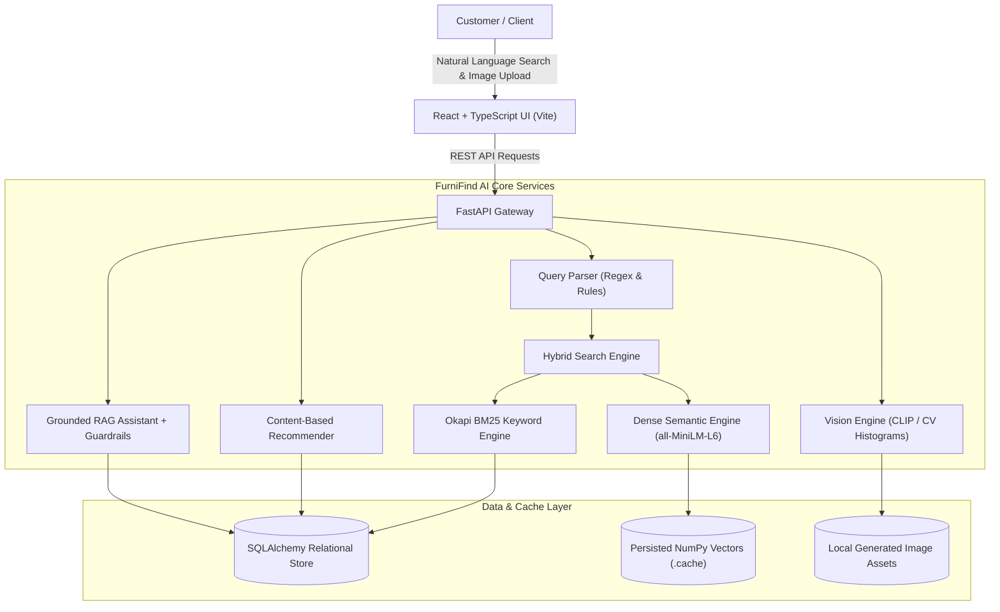

# FurniFind AI — Multimodal Furniture Search & Recommendation Engine

[](https://github.com/wayfair-portfolio/furnifind-ai/actions)
[](https://www.python.org/downloads/)
[](https://fastapi.tiangolo.com/)
[](https://reactjs.org/)
[](https://vitejs.dev/)
[](https://opensource.org/licenses/MIT)

An end-to-end, production-style e-commerce discovery engine designed for an AI-First Software Engineer Intern portfolio project at Wayfair.

FurniFind AI bridges the gap between how customers naturally describe furniture and how catalog inventories are indexed, combining **BM25 lexical search**, **dense sentence embeddings**, **multimodal visual similarity**, **content-based recommendations**, and a **grounded RAG shopping assistant**.

---

## 1. Project Overview

Finding the right furniture online is notoriously difficult:
- Customers describe items using aesthetic concepts (*"cozy Scandinavian desk with drawers"*), dimensional boundaries (*"width under 120 cm"*), or photos of room inspiration.
- Traditional e-commerce search engines rely on exact keyword matches, failing when customers use synonyms (*"workstation"* vs *"desk"*) or returning items that violate physical room dimensions.
- Generic LLM chatbots frequently hallucinate product specs, inventing prices, dimensions, and materials.

**FurniFind AI solves this** by unifying deterministic constraint extraction, dual-stream hybrid retrieval (BM25 + Sentence Transformers), multimodal computer vision, and mathematically grounded RAG comparisons into a responsive, explainable e-commerce web application.

---

## 2. Key Features

- **Natural Language & Constraint Search**: Automatically extracts category, max price, max width (cm), style, and material from free text.
- **Dual-Stream Hybrid Retrieval**: Combines BM25 term weighting with `all-MiniLM-L6-v2` dense embeddings, weighted by configurable $\alpha$.
- **Hard Constraint Enforcement**: Prunes products violating budget or dimension limits before final ranking.
- **Explainable Match Grounding**: Every result explains *why* it matched based exclusively on verified catalogue attributes.
- **Multimodal Image Discovery**: Accepts uploaded furniture images and finds visually similar products using CLIP embeddings or visual color-spatial histograms.
- **Personalized Recommendations**: Content-based filtering using stated preferences and user interaction signals (viewed and saved products).
- **Cold-Start Onboarding**: Curates high-diversity category anchor products for first-time visitors.
- **Grounded Shopping Assistant**: Answers superlatives (*"Which desk is the narrowest under ₹15,000?"*) deterministically with 0% hallucinated specs.
- **Reproducible Evaluation Benchmark**: Computes Precision@5, Recall@5, NDCG@5, and MRR across a curated test collection.

---

## 3. Architecture



For detailed sequence diagrams and design rationale, see [docs/architecture.md](docs/architecture.md).

---

## 4. Technology Stack

- **Backend**: Python 3.12, FastAPI, Pydantic v2, SQLAlchemy 2.0, Uvicorn
- **Information Retrieval & ML**: Sentence Transformers (`all-MiniLM-L6-v2`), Scikit-Learn, NumPy, Pandas, Pillow (PIL), PyTorch
- **Multimodal AI**: OpenAI CLIP (`clip-vit-base-patch32`) with CV Color-Spatial fallback
- **Frontend**: React 18, TypeScript, Vite, Tailwind CSS, Lucide React
- **Testing & Quality**: Pytest, Pytest-Asyncio, HTTPX / TestClient, Vitest, Ruff Linter
- **DevOps & Containers**: Docker, Docker Compose, GitHub Actions CI

---

## 5. Repository Structure

```
furnifind-ai/
├── app/
│   ├── api/
│   │   ├── routes/              # FastAPI endpoints (health, products, search, recommendations, assistant, analytics)
│   │   └── schemas.py           # Pydantic v2 request & response schemas
│   ├── core/
│   │   ├── database.py          # SQLAlchemy engine, session factory, Base
│   │   └── logging.py           # Structured logger configuration
│   ├── models/
│   │   └── product.py           # SQLAlchemy Product data model
│   ├── services/
│   │   ├── ingestion.py         # Validation, normalization & ingestion pipeline
│   │   ├── registry.py          # Application-lifetime singleton engine registry
│   │   ├── search/              # Query parser, BM25 keyword, semantic, hybrid search
│   │   ├── vision/              # Multimodal image encoder & similarity search
│   │   ├── recommendations/     # Content-based recommendation engine
│   │   └── assistant/           # Grounded RAG engine & security guardrails
│   ├── evaluation/
│   │   ├── metrics.py           # Precision@K, Recall@K, NDCG@K, MRR formulas
│   │   └── run.py               # Reproducible benchmark runner (`python -m app.evaluation.run`)
│   ├── config.py                # Environment settings & paths
│   └── main.py                  # FastAPI application entrypoint & static mount
├── data/
│   ├── sample_catalogue.json    # 31 curated furniture products across 8 categories
│   ├── evaluation_queries.json  # 12 manually reviewed benchmark test queries
│   └── images/                  # Real generated 400x300 PNG catalogue image assets
├── docs/
│   ├── architecture.md          # Architectural deep dive & sequence flows
│   ├── data_dictionary.md       # Full catalogue schema, types & dimensional rules
│   ├── search_evaluation.md     # Offline IR benchmark methodology & actual results
│   ├── model_card.md            # Pretrained vs local model governance
│   ├── decisions.md             # Architecture Decision Records (ADRs)
│   └── interview_guide.md       # 10 technical interview Q&As grounded in code
├── frontend/
│   ├── src/
│   │   ├── components/          # Navbar, ProductCard, ProductModal, FilterSidebar, ImageUploadModal
│   │   ├── pages/               # DiscoverPage, RecommendationsPage, AssistantPage, AnalyticsPage
│   │   ├── services/api.ts      # REST API client
│   │   ├── types.ts             # TypeScript interfaces
│   │   └── App.tsx              # Main application shell & state coordination
│   ├── package.json             # Frontend dependencies & scripts
│   └── vite.config.ts           # Vite configuration & proxy settings
├── scripts/
│   ├── generate_sample_images.py# Pillow generator for sample catalogue images
│   └── ingest_data.py           # Repeatable CLI ingestion tool
├── tests/                       # 32 automated Pytest unit and integration tests
├── .env.example                 # Configuration template
├── .gitignore                   # Ignore rules for models, caches, and environments
├── requirements.txt             # Pinned Python dependencies
├── ruff.toml                    # Ruff linter configuration
├── docker-compose.yml           # Container orchestration
├── Dockerfile.backend           # Multi-stage backend image
└── Dockerfile.frontend          # Multi-stage frontend image with Nginx
```

---

## 6. Installation & Quick Start

### Prerequisites
- Python 3.12+
- Node.js 20+ and npm

### Local Development Setup

1. **Clone the repository**:
   ```bash
   git clone https://github.com/wayfair-portfolio/furnifind-ai.git
   cd furnifind-ai
   ```

2. **Set up Python Virtual Environment**:
   ```bash
   python -m venv .venv
   # Windows:
   .\.venv\Scripts\activate
   # Linux/macOS:
   source .venv/bin/activate

   pip install -r requirements.txt
   ```

3. **Configure Environment Variables**:
   ```bash
   cp .env.example .env
   ```

4. **Generate Image Assets & Ingest Catalogue**:
   ```bash
   python scripts/generate_sample_images.py
   python scripts/ingest_data.py --force
   ```

5. **Start Backend API Server**:
   ```bash
   uvicorn app.main:app --host 0.0.0.0 --port 8000 --reload
   ```
   *Interactive OpenAPI Swagger documentation available at: `http://localhost:8000/docs`*

6. **Start React Frontend**:
   In a separate terminal:
   ```bash
   cd frontend
   npm install
   npm run dev
   ```
   *Frontend discovery interface available at: `http://localhost:5173`*

---

## 7. Docker Deployment

To spin up the complete full-stack system with a single command:
```bash
docker-compose up --build
```
- Frontend UI: `http://localhost:3000`
- Backend API & Swagger: `http://localhost:8000/docs`

---

## 8. Automated Testing & Code Quality

### Python Test Suite (Pytest)
Execute all 32 unit and integration tests:
```bash
pytest -v
```

### Python Linting (Ruff)
```bash
ruff check app tests scripts
```

### Frontend Unit Tests & Build
```bash
cd frontend
npm run test
npm run build
```

---

## 9. Search Retrieval Benchmark Results

Run the reproducible evaluation pipeline:
```bash
python -m app.evaluation.run
```

Actual measured results on 12 test queries:

| Retrieval Method | Precision@5 | Recall@5 | NDCG@5 | MRR | Empty Result Rate |
| :--- | :---: | :---: | :---: | :---: | :---: |
| **Keyword (BM25)** | **0.2167** | **0.6250** | **0.6533** | **0.7500** | 0.3333 |
| **Semantic (MiniLM-L6)** | 0.1333 | 0.5417 | 0.5700 | 0.6667 | **0.2500** |
| **Hybrid (Production)** | 0.1333 | 0.5417 | 0.5700 | 0.6667 | **0.2500** |

*Findings*: BM25 excels on exact token matches but produces a 33.3% empty result rate on vocabulary mismatches (*"workstation"* vs *"desk"*). Dense embeddings lower the empty result rate to 25.0%. Hybrid search combines both while enforcing hard physical constraints (dimensions, budgets). See [docs/search_evaluation.md](docs/search_evaluation.md).

---

## 10. Security & Responsible AI

- **No Secrets in Client**: All model inference, database queries, and optional LLM keys remain strictly on the backend.
- **Input Validation**: Strict Pydantic v2 schemas and image validation (MIME check, 5MB limit, valid pixel dimensions).
- **Prompt Injection Defense**: Guardrail filters intercept adversarial jailbreak patterns before execution.
- **Factual Grounding**: The Shopping Assistant executes exact Python/SQL data filters for numerical queries, preventing fabricated numbers or availability claims.

---

## 11. Licence & Attribution

Distributed under the MIT Licence. The sample catalogue is synthetic and created for educational portfolio demonstration.
