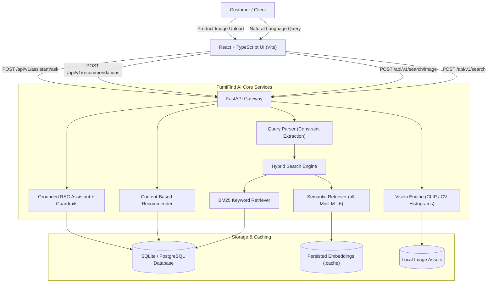
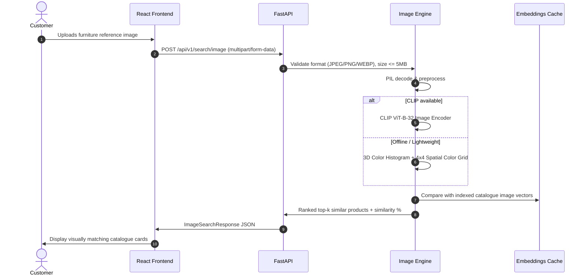

# FurniFind AI — Architecture & System Design

## 1. System Overview

FurniFind AI is an end-to-end multimodal e-commerce discovery engine designed to bridge the gap between how customers describe home furnishings and how structured catalogues are indexed.

---

## 2. Information Retrieval Pipeline

### A. Query Understanding & Filter Extraction
When a query such as `"Scandinavian light oak study desk with drawers, width below 120 cm, under ₹15000"` arrives:
1. **Deterministic Rule Engine**: Matches dimensional patterns (`width below 120 cm`), budget patterns (`under 15000`), categories (`desk`), styles (`scandinavian`), and materials (`oak`).
2. **Residual Generation**: Extracts the constraint tokens from the query while retaining descriptive contextual nuances (`"with drawers"`).
3. **Hard Constraint Enforcement**: Filters out products violating mandatory constraints before final ranking, preventing high-semantic but rule-violating items from ranking.

### B. Dual-Stream Candidate Retrieval
1. **Lexical Baseline (BM25)**:
   - Term Frequency with sub-linear saturation ($k_1 = 1.5, b = 0.75$).
   - Lucene-style Inverse Document Frequency:
     $$\text{IDF}(t) = \ln\left(1 + \frac{N - n(t) + 0.5}{n(t) + 0.5}\right)$$
   - Weighted multi-field indexing: Title ($3\times$), Category ($2\times$), Material ($2\times$), Style ($2\times$), Description ($1\times$).
2. **Dense Semantic Retrieval**:
   - Encodes text with `sentence-transformers/all-MiniLM-L6-v2` into 384-dimensional unit vectors.
   - Computes cosine similarity:
     $$\text{Sim}_{\text{dense}}(q, d) = \frac{\mathbf{q} \cdot \mathbf{d}}{\|\mathbf{q}\| \|\mathbf{d}\|}$$

### C. Hybrid Ranking Formula
For candidates surviving hard constraint checks, the final hybrid score combines normalized lexical and semantic scores:
$$\text{Score}_{\text{hybrid}} = (1 - \alpha) \cdot \text{Score}_{\text{BM25\_norm}} + \alpha \cdot \text{Score}_{\text{dense}}$$
Where $\alpha \in [0, 1]$ defaults to $0.5$ in hybrid mode.

---

## 3. Multimodal Vision Pipeline

---

## 4. Grounded RAG Shopping Assistant & Guardrails

The assistant implements strict factual grounding to prevent hallucinations in e-commerce:

1. **Prompt Injection Defense**: Evaluates inputs against adversarial patterns (`ignore previous instructions`, `reveal system prompt`, script tags).
2. **Question Intent Classification**:
   - *Superlative & Comparison*: Python/SQL execution calculates minimum width, maximum dimensions, or lowest price deterministically.
   - *Direct Product Specs*: Queries specific product attributes and explicitly reports missing specifications (`Dimensions not recorded in catalogue`).
   - *General Discovery*: Feeds verified hybrid search candidates into structured response assembler.
3. **Factual Verification Guardrail**: Cross-checks numerical values in the generated text against verified attribute sets before returning.
